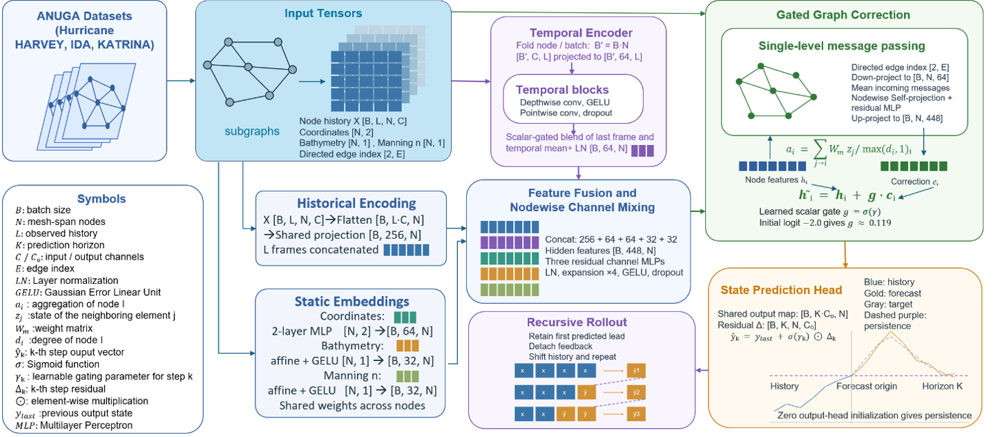

# CoastSpanNet

**Coastal Subgraph Spatiotemporal Forecasting Network**

CoastSpanNet focuses on computational efficiency and scalability by combining temporal convolutional encoding, coordinate-aware spatial embeddings, lightweight graph correction, and persistence-based forecasting within a unified framework. The architecture is designed for cross-dataset learning on arbitrary coastal subgraphs with node counts that may vary across simulations. 

<picture>

</picture>
